# LAPORAN PRAKTIKUM 6
# JAVASCRIPT DOM & EVENT HANDLING

<p align="center">
  <strong>PROJECT LAB6WEB</strong><br>
  Mata Kuliah Pemrograman Web
</p>

---

## IDENTITAS

| Keterangan | Informasi |
|---|---|
| Nama | Tiara Az Zahra |
| Program Studi | Teknik Informatika |
| Perguruan Tinggi | Universitas Pelita Bangsa |
| Mata Kuliah | Pemrograman Web |
| Praktikum | Praktikum 6 |
| Materi | JavaScript DOM & Event Handling |
| Nama Project | Lab6Web |

---

## 1. DESKRIPSI PROJECT

Project Lab6Web merupakan hasil pengerjaan Praktikum 6 pada mata kuliah Pemrograman Web dengan materi JavaScript DOM (Document Object Model) dan Event Handling.

Praktikum ini berfokus pada penerapan JavaScript untuk membuat halaman web yang interaktif. Melalui kegiatan ini, HTML tidak hanya digunakan untuk membangun struktur halaman, tetapi juga dapat dimanipulasi menggunakan JavaScript agar dapat merespons tindakan pengguna.

Pada project ini diterapkan beberapa fungsi, mulai dari memilih elemen HTML, mengubah isi elemen, mengubah tampilan melalui CSS, menangani event klik, menghitung jumlah karakter, melakukan validasi form, hingga membuat aplikasi daftar tugas sederhana.

Selain latihan dasar, project ini juga dilengkapi dengan Mini Project berupa formulir pendaftaran workshop dan beberapa eksperimen mandiri untuk memahami perilaku JavaScript ketika dijalankan pada halaman web.

Project dibuat menggunakan HTML, CSS, dan JavaScript tanpa menggunakan framework tambahan.

## 2. TUJUAN PRAKTIKUM

Tujuan dari pelaksanaan Praktikum 6 ini adalah:

1. Memahami pengertian dan fungsi Document Object Model (DOM).
2. Mengetahui hubungan antara HTML, CSS, dan JavaScript dalam membangun halaman web.
3. Memahami cara memilih elemen HTML menggunakan JavaScript.
4. Menerapkan perubahan isi dan atribut elemen HTML melalui DOM.
5. Memahami penggunaan event listener untuk menangani interaksi pengguna.
6. Menerapkan manipulasi class CSS menggunakan JavaScript.
7. Membuat penghitung karakter secara langsung melalui event input.
8. Membuat validasi form menggunakan JavaScript.
9. Mengembangkan fitur To-do List sederhana.
10. Menerapkan konsep DOM dan Event Handling dalam sebuah Mini Project.
11. Memahami perbedaan waktu eksekusi JavaScript dengan dan tanpa atribut defer.

## 3. DASAR TEORI

### 3.1 Document Object Model (DOM)

Document Object Model atau DOM merupakan representasi dokumen HTML dalam bentuk struktur objek yang dapat diakses oleh JavaScript.

Dengan DOM, JavaScript dapat berinteraksi dengan elemen HTML, seperti mengambil elemen berdasarkan ID, mengubah teks, menambahkan elemen baru, menghapus elemen, dan mengubah tampilan halaman.

Beberapa metode yang digunakan untuk mengakses elemen DOM antara lain:

- `document.getElementById()` untuk mengambil elemen berdasarkan ID.
- `document.querySelector()` untuk mengambil elemen pertama berdasarkan selector CSS.
- `document.querySelectorAll()` untuk mengambil seluruh elemen yang sesuai dengan selector CSS.

### 3.2 Manipulasi DOM

Manipulasi DOM adalah proses mengubah struktur, isi, atau atribut elemen HTML menggunakan JavaScript.

Contoh properti dan metode yang digunakan:

- `textContent` untuk mengubah teks.
- `innerHTML` untuk mengatur isi HTML.
- `style` untuk mengubah gaya elemen secara langsung.
- `classList.add()` untuk menambahkan class.
- `classList.remove()` untuk menghapus class.
- `classList.toggle()` untuk mengaktifkan atau menonaktifkan class.

### 3.3 Event Handling

Event Handling merupakan mekanisme untuk menangani suatu kejadian atau tindakan yang dilakukan pengguna pada halaman web.

Contohnya adalah ketika pengguna menekan tombol, mengetik pada kolom input, memilih pilihan, atau mengirim formulir.

Salah satu metode yang digunakan adalah:

`addEventListener()`

Beberapa event yang digunakan dalam project ini:

| Event | Fungsi |
|---|---|
| click | Menangani klik tombol |
| input | Mendeteksi perubahan isi input |
| change | Mendeteksi perubahan pilihan |
| submit | Menangani pengiriman form |

### 3.4 Validasi Form

Validasi form merupakan proses pemeriksaan data yang dimasukkan pengguna sebelum data diproses.

Validasi dilakukan untuk memastikan bahwa data yang dimasukkan sesuai dengan ketentuan yang telah ditentukan.

Pada project ini validasi digunakan untuk memeriksa nama, format email, dan usia pada formulir latihan, serta data pendaftaran pada Mini Project.

## 4. TEKNOLOGI YANG DIGUNAKAN

| Teknologi | Kegunaan |
|---|---|
| HTML5 | Membuat struktur halaman website |
| CSS3 | Mengatur desain dan tampilan website |
| JavaScript | Membuat fungsi interaktif dan manipulasi DOM |
| Visual Studio Code | Menulis dan mengelola source code |
| Web Browser | Menjalankan dan menguji website |
| Developer Tools | Memeriksa hasil eksekusi JavaScript melalui Console |
| GitHub | Menyimpan dan mendokumentasikan project |

## 5. STRUKTUR FOLDER PROJECT

```text
Lab6Web/
│
├── index.html
├── style.css
├── script.js
├── eksperimen-5-tanpa-defer.html
├── README.md
├── Modul_Praktikum_6_Referensi.pdf
├── CHECKLIST-SEBELUM-DIKUMPULKAN.txt
│
└── screenshots/
    ├── 00-tampilan-utama-website.png
    ├── 00A-sumber-screenshot-full-page-asli.png
    ├── 01-latihan-1-dom.png
    ├── 02-latihan-2-event-click.png
    ├── 03-latihan-3-manipulasi-css.png
    ├── 04-latihan-4-penghitung-karakter.png
    ├── 05-latihan-5-form-tampilan-utama.png
    ├── 06-latihan-6-todo-list.png
    ├── 07-mini-project-workshop-berhasil.png
    ├── 08-eksperimen-mandiri-3-dan-4.png
    ├── 09-jawaban-evaluasi.png
    ├── 10A-validasi-semua-kolom-kosong.png
    ├── 10B-validasi-nama-kosong.png
    ├── 10C-validasi-email-tidak-valid.png
    ├── 10D-validasi-usia-16-tahun.png
    ├── 10E-validasi-data-berhasil.png
    ├── 11-mini-project-validasi-gagal.png
    ├── 12-eksperimen-5-halaman-tanpa-defer.png
    ├── 13-eksperimen-5-console-null-dan-typeerror.png
    ├── 14A-todo-tambah-tiga-tugas.png
    ├── 14B-todo-tandai-selesai.png
    ├── 14C-todo-hapus-tugas.png
    ├── 15A-mini-project-pendaftaran-berhasil.png
    ├── 15B-mini-project-validasi-gagal.png
    ├── 16A-eksperimen-3-4-paragraf-terlihat.png
    ├── 16B-eksperimen-3-4-paragraf-tersembunyi.png
    └── 17-eksperimen-5-tanpa-defer-hasil-pengamatan.png
```

### Penjelasan file project

**1. index.html**

Merupakan file utama yang berisi struktur halaman website, bagian latihan, formulir, To-do List, Mini Project, dan eksperimen mandiri.

**2. style.css**

Berisi kode CSS yang digunakan untuk mengatur desain halaman, warna, ukuran elemen, tata letak, jarak, dan tampilan website.

**3. script.js**

Merupakan file JavaScript utama yang berisi logika program, manipulasi DOM, event listener, validasi form, pengelolaan To-do List, dan proses pendaftaran workshop.

**4. eksperimen-5-tanpa-defer.html**

Merupakan halaman khusus untuk menguji proses eksekusi JavaScript tanpa menggunakan atribut defer.

**5. README.md**

Berisi dokumentasi project, penjelasan materi, fitur, skenario pengujian, dan dokumentasi hasil praktikum.

**6. Modul_Praktikum_6_Referensi.pdf**

Merupakan file modul praktikum yang digunakan sebagai referensi pengerjaan.

**7. screenshots/**

Folder yang berisi dokumentasi visual hasil pengerjaan, tampilan website, dan bukti pengujian fitur.

## 6. HASIL IMPLEMENTASI LATIHAN

### 6.1 Latihan 1 – Mengakses dan Mengubah Elemen DOM

Pada latihan pertama, JavaScript digunakan untuk mengakses elemen HTML berdasarkan ID. Setelah elemen ditemukan, isi teks diubah menggunakan properti `textContent`.

Tujuan latihan ini adalah memahami bagaimana JavaScript dapat mengambil dan mengubah konten elemen HTML secara langsung tanpa harus mengubah struktur HTML secara manual.

**Dokumentasi:**

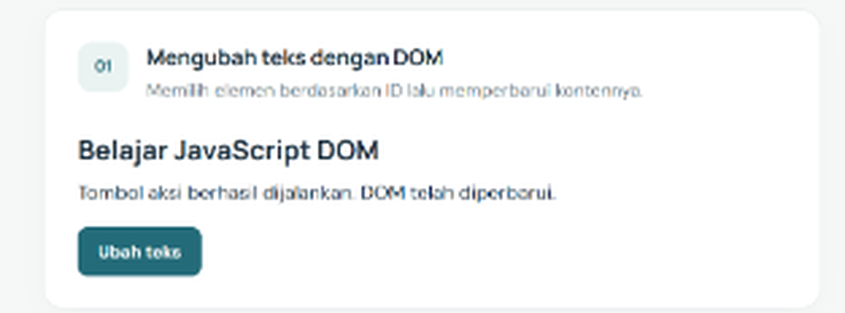

### 6.2 Latihan 2 – Event Click

Pada latihan kedua, digunakan event `click` untuk mendeteksi ketika pengguna menekan tombol.

Ketika tombol diklik, JavaScript menjalankan fungsi yang telah ditentukan dan memperbarui informasi pada halaman.

Latihan ini menunjukkan bahwa suatu tindakan pengguna dapat menjadi pemicu untuk menjalankan perintah JavaScript.

**Dokumentasi:**

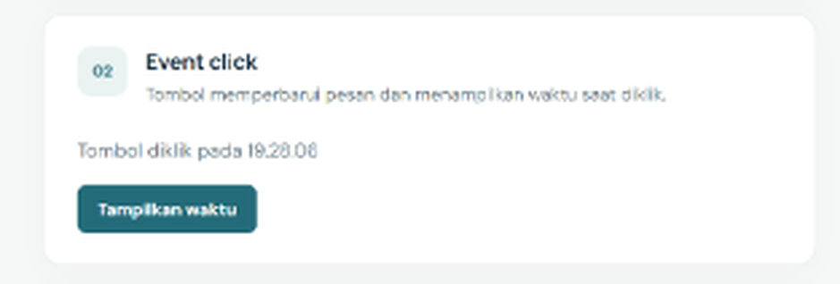

### 6.3 Latihan 3 – Manipulasi CSS dengan JavaScript

Pada latihan ketiga, JavaScript digunakan untuk mengubah tampilan elemen HTML melalui manipulasi class CSS.

Metode `classList.toggle()` digunakan untuk menambahkan atau menghapus class pada elemen. Dengan demikian, tampilan elemen dapat berubah sesuai interaksi pengguna.

**Dokumentasi:**

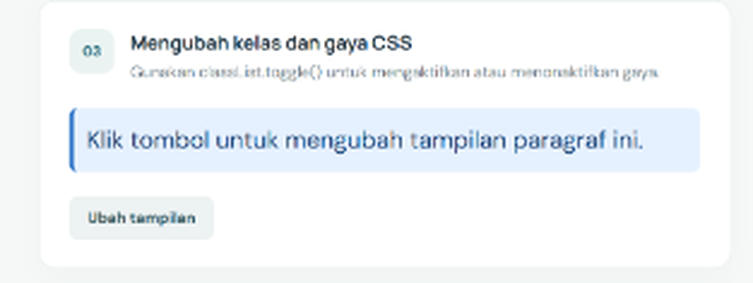

### 6.4 Latihan 4 – Penghitung Karakter

Pada latihan keempat, dibuat fitur penghitung karakter menggunakan event `input`.

Setiap kali pengguna mengetik atau menghapus karakter pada kolom input, JavaScript akan membaca jumlah karakter melalui properti `value.length`.

Hasil perhitungan ditampilkan secara langsung pada halaman.

**Dokumentasi:**

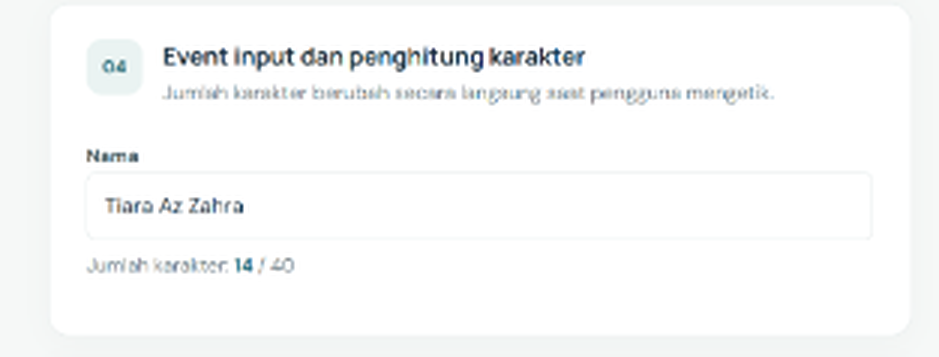

### 6.5 Latihan 5 – Validasi Form

Latihan kelima menerapkan validasi formulir menggunakan JavaScript.

Pemeriksaan dilakukan terhadap beberapa data, yaitu nama, alamat email, dan usia. Program memberikan pesan sesuai dengan kondisi data yang dimasukkan pengguna.

Tujuan latihan ini adalah memastikan data yang dikirimkan memenuhi ketentuan sebelum dinyatakan berhasil.

**Dokumentasi tampilan form:**

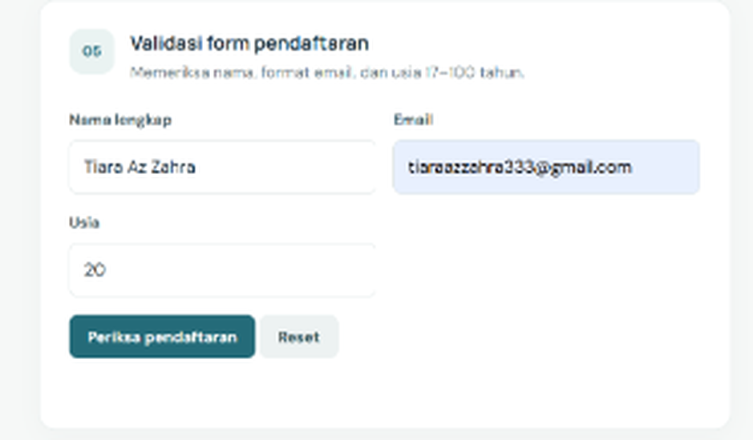

**Pengujian validasi:**

| Pengujian | Screenshot |
|---|---|
| Semua kolom kosong | `10A-validasi-semua-kolom-kosong.png` |
| Nama kosong | `10B-validasi-nama-kosong.png` |
| Email tidak valid | `10C-validasi-email-tidak-valid.png` |
| Usia 16 tahun | `10D-validasi-usia-16-tahun.png` |
| Data berhasil divalidasi | `10E-validasi-data-berhasil.png` |

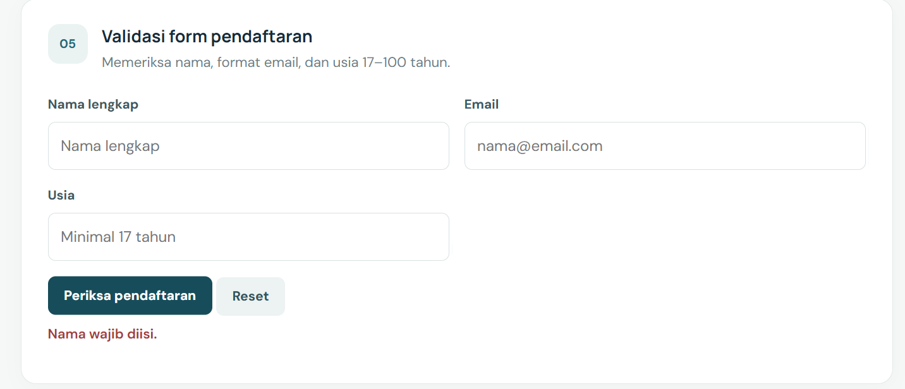

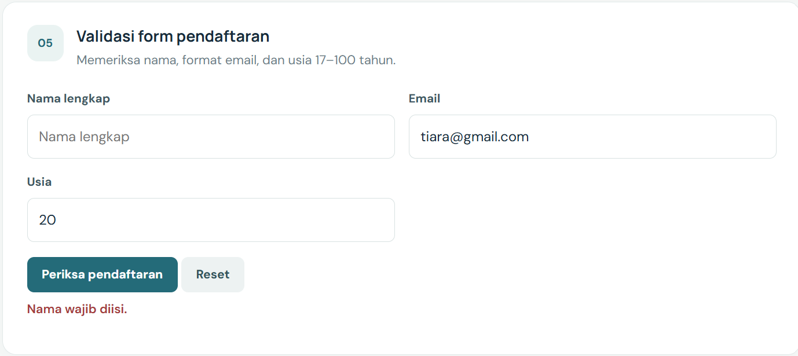

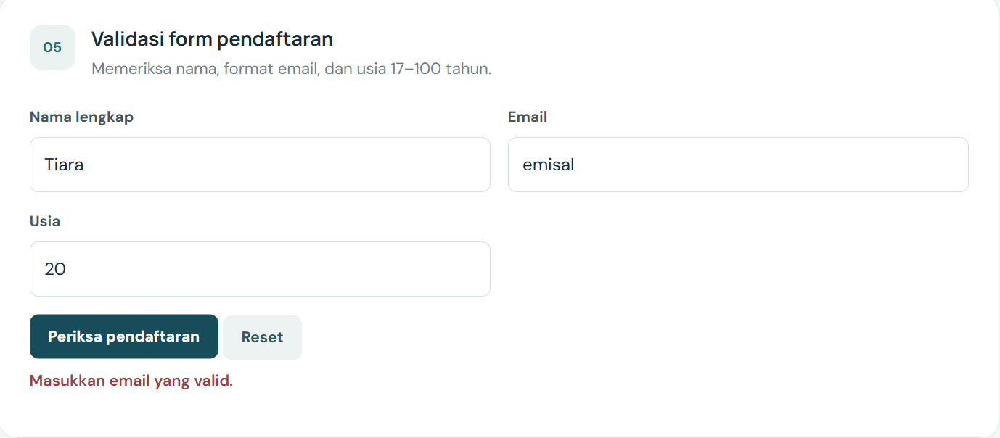

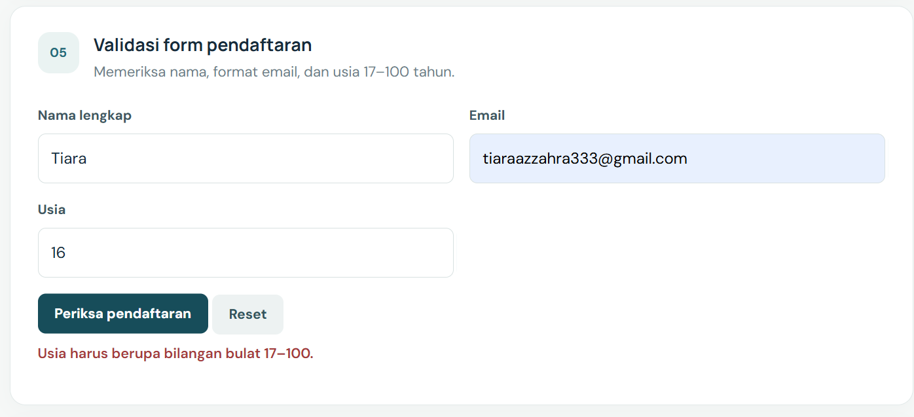

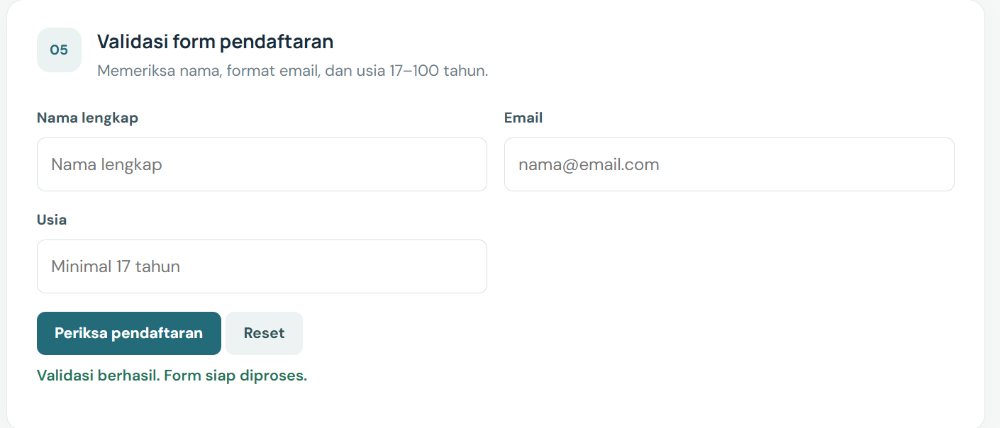

### 6.6 Latihan 6 – To-do List

Pada latihan keenam, dibuat aplikasi daftar tugas sederhana atau To-do List.

Fitur ini memungkinkan pengguna untuk mengelola daftar pekerjaan melalui tiga fungsi utama, yaitu menambahkan tugas, menandai tugas sebagai selesai, dan menghapus tugas.

**Fungsi yang tersedia:**

1. Tambah tugas: memasukkan tugas baru ke dalam daftar.
2. Tandai selesai: mengubah status tugas menjadi selesai.
3. Hapus tugas: menghapus tugas tertentu dari daftar.

**Dokumentasi tampilan latihan:**

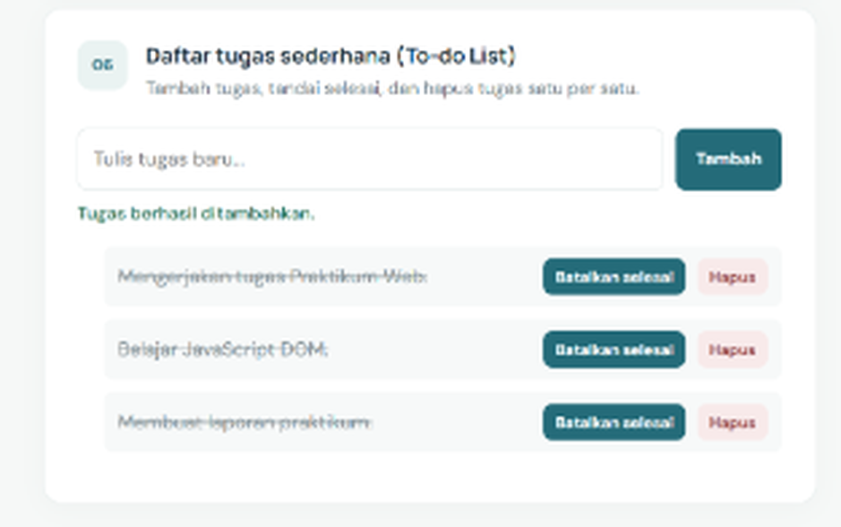

**Pengujian tambah tugas:**

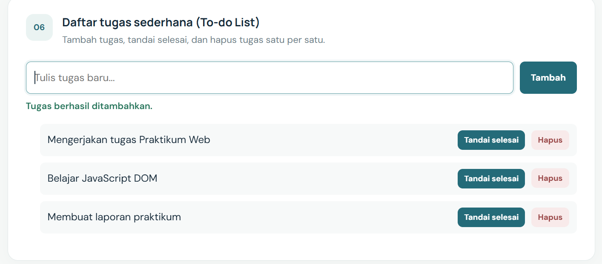

**Pengujian menandai tugas selesai:**

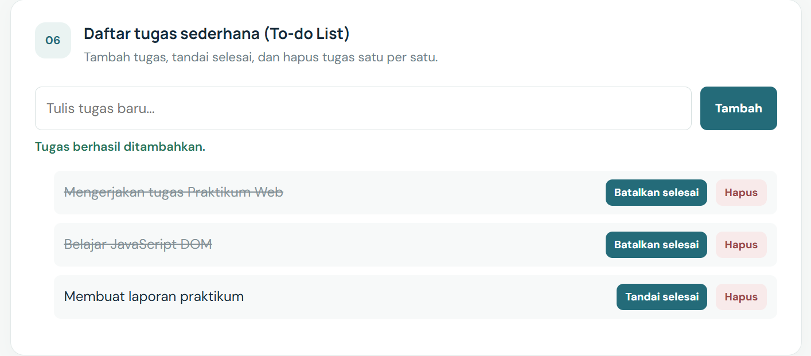

**Pengujian menghapus tugas:**

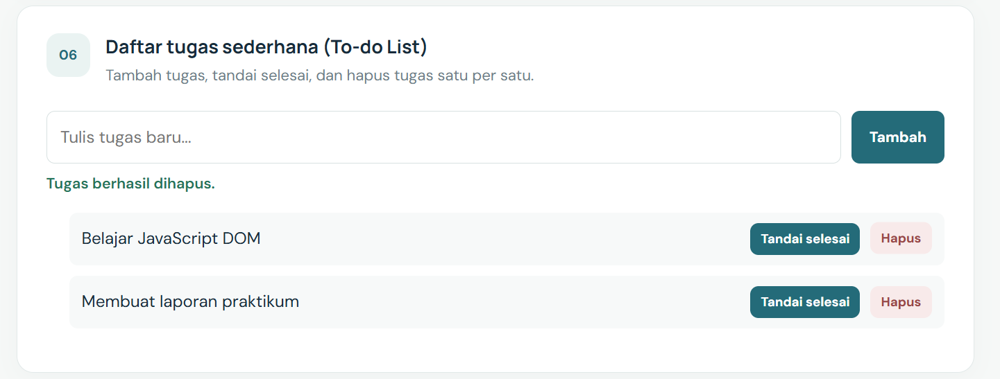

## 7. MINI PROJECT – FORM PENDAFTARAN WORKSHOP

Mini Project pada Praktikum 6 berupa formulir pendaftaran workshop yang menerapkan konsep DOM, event handling, dan validasi input.

Formulir ini dibuat agar pengguna dapat memasukkan identitas dan memilih sesi workshop yang tersedia.

### 7.1 Fitur Mini Project

Fitur yang diterapkan meliputi:

- Input nama lengkap.
- Input alamat email.
- Pilihan sesi workshop.
- Penghitung karakter nama.
- Informasi sesi yang dipilih.
- Pemeriksaan kelengkapan data.
- Validasi nama minimal tiga karakter.
- Validasi format email.
- Pesan kesalahan jika data tidak sesuai.
- Pesan keberhasilan jika pendaftaran berhasil.

### 7.2 Proses Kerja Program

Ketika pengguna memasukkan nama, program akan menghitung jumlah karakter secara langsung.

Ketika pengguna mengubah pilihan sesi, informasi sesi akan diperbarui.

Saat formulir dikirim, JavaScript memeriksa data yang dimasukkan. Jika data tidak memenuhi ketentuan, program menampilkan pesan kesalahan. Sebaliknya, jika seluruh data sesuai, program menampilkan pesan bahwa pendaftaran berhasil.

### 7.3 Dokumentasi Mini Project

**Tampilan utama Mini Project:**

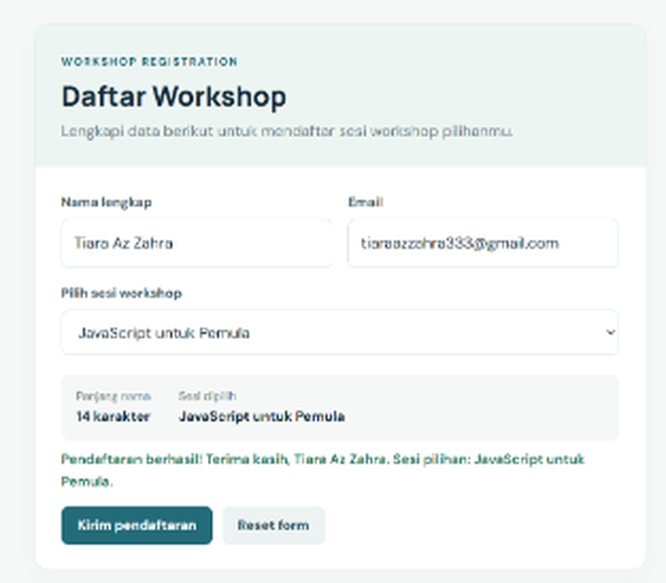

**Pengujian pendaftaran berhasil:**

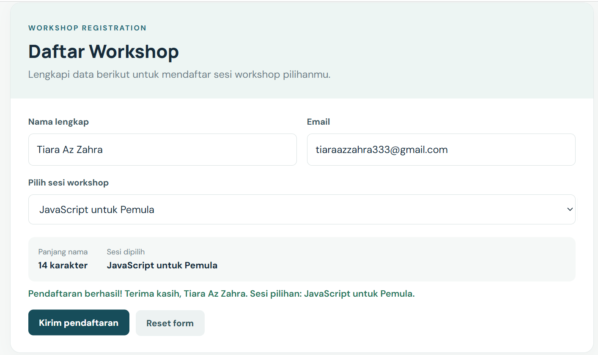

**Pengujian validasi gagal:**

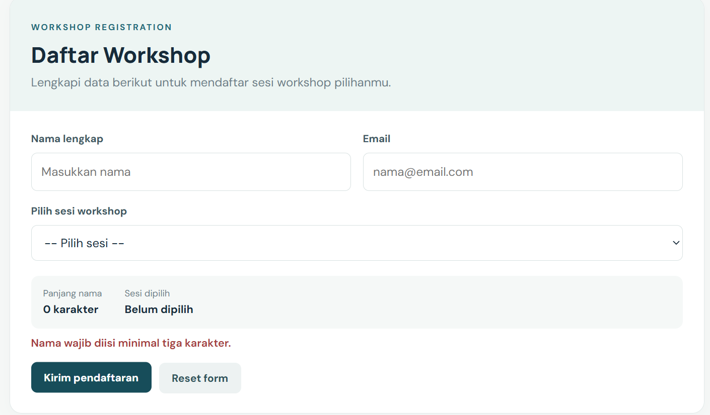

## 8. EKSPERIMEN MANDIRI

### 8.1 Eksperimen 1 – Menghapus Item

Eksperimen ini menerapkan fungsi penghapusan elemen dari daftar menggunakan JavaScript DOM.

Pada project, fungsi penghapusan dapat dilihat pada fitur To-do List. Setiap tugas memiliki tombol hapus yang dapat digunakan untuk menghilangkan tugas tertentu dari daftar.

### 8.2 Eksperimen 2 – Validasi Minimal Tiga Karakter

Eksperimen ini menerapkan pemeriksaan panjang karakter pada input nama.

Nama yang dimasukkan harus memenuhi ketentuan minimal tiga karakter. Apabila nama belum memenuhi ketentuan, program menampilkan pesan validasi.

Penerapan ini juga digunakan pada formulir Mini Project.

### 8.3 Eksperimen 3 – Event Change

Eksperimen ini menggunakan event `change` untuk mendeteksi perubahan nilai pada elemen pilihan.

Ketika pengguna mengganti pilihan sesi workshop, JavaScript membaca nilai terbaru dan memperbarui informasi yang ditampilkan.

### 8.4 Eksperimen 4 – Menyembunyikan dan Menampilkan Paragraf

Eksperimen ini menunjukkan penggunaan JavaScript untuk mengubah visibilitas suatu elemen HTML.

Pengguna dapat menekan tombol untuk menyembunyikan paragraf dan menekan tombol lainnya untuk menampilkannya kembali.

**Pengujian paragraf terlihat:**

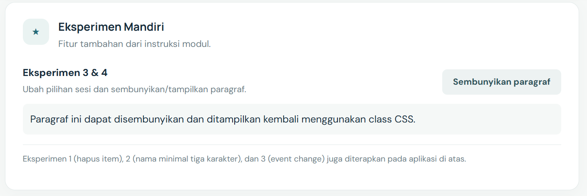

**Pengujian paragraf tersembunyi:**

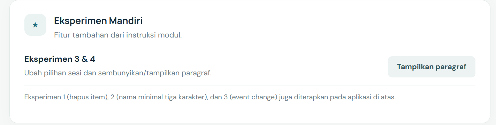

### 8.5 Eksperimen 5 – JavaScript Tanpa Atribut Defer

Eksperimen ini dilakukan untuk memahami pengaruh waktu pemuatan HTML terhadap proses eksekusi JavaScript.

Pada halaman `eksperimen-5-tanpa-defer.html`, script dijalankan tanpa atribut `defer`.

Ketika browser membaca script pada bagian head, elemen HTML yang berada di bagian body belum selesai diproses. Akibatnya, ketika JavaScript mencoba mengambil elemen menggunakan `document.getElementById()`, hasilnya dapat berupa `null`.

Jika program kemudian memanggil `addEventListener()` pada nilai `null`, browser akan menghasilkan kesalahan `TypeError`.

**Dokumentasi halaman eksperimen:**


**Dokumentasi hasil Console:**

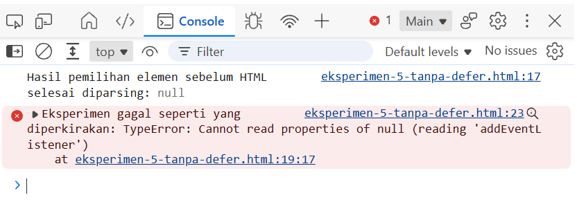

**Hasil pengamatan:**

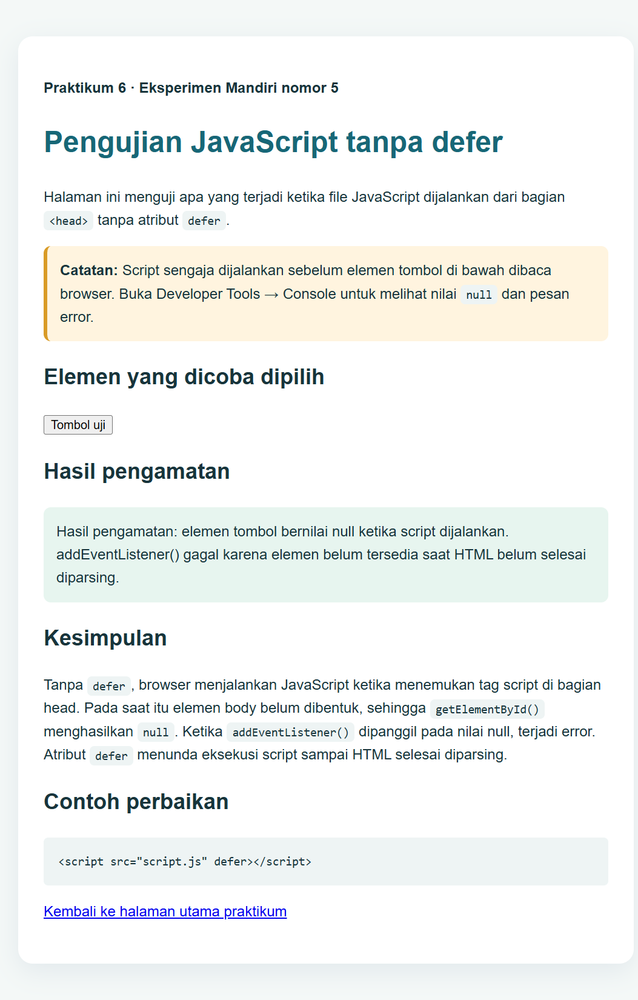

Salah satu cara untuk mengatasi masalah urutan eksekusi tersebut adalah menggunakan atribut `defer` pada script eksternal.

Contoh:

```html
<script src="script.js" defer></script>
```

Dengan atribut `defer`, browser akan menjalankan script setelah dokumen HTML selesai diparsing.

## 9. SKENARIO DAN HASIL PENGUJIAN

Pengujian dilakukan untuk memastikan fungsi-fungsi yang dibuat dapat berjalan sesuai tujuan.

### 9.1 Pengujian DOM dan Event

| No. | Fitur | Hasil yang Diharapkan |
|---|---|---|
| 1 | Mengubah teks | Isi elemen berubah |
| 2 | Tombol click | Fungsi berjalan saat tombol diklik |
| 3 | Manipulasi CSS | Tampilan elemen berubah |
| 4 | Penghitung karakter | Jumlah karakter diperbarui |

### 9.2 Pengujian Validasi Form

| No. | Kondisi | Hasil |
|---|---|---|
| 1 | Semua kolom kosong | Pesan validasi muncul |
| 2 | Nama tidak diisi | Pesan nama wajib diisi |
| 3 | Email salah | Pesan email tidak valid |
| 4 | Usia 16 tahun | Data ditolak |
| 5 | Semua data sesuai | Validasi berhasil |

### 9.3 Pengujian To-do List

| No. | Skenario | Hasil |
|---|---|---|
| 1 | Menambahkan tugas | Tugas muncul pada daftar |
| 2 | Menandai tugas selesai | Tugas ditampilkan tercoret |
| 3 | Menghapus tugas | Tugas hilang dari daftar |

### 9.4 Pengujian Mini Project

| No. | Skenario | Hasil |
|---|---|---|
| 1 | Data pendaftaran lengkap dan valid | Pesan pendaftaran berhasil |
| 2 | Nama tidak memenuhi ketentuan | Pesan kesalahan ditampilkan |
| 3 | Email tidak sesuai format | Validasi email ditampilkan |
| 4 | Sesi belum dipilih | Pengguna diminta memilih sesi |

## 10. JAWABAN EVALUASI

### 1. Apa yang dimaksud dengan DOM dan apa manfaatnya?

DOM (Document Object Model) merupakan representasi dokumen HTML dalam bentuk objek yang dapat diakses oleh JavaScript.

Manfaat DOM adalah memungkinkan JavaScript untuk memilih, mengubah, menambahkan, dan menghapus elemen HTML secara dinamis sehingga halaman web menjadi lebih interaktif.

### 2. Apa perbedaan getElementById(), querySelector(), dan querySelectorAll()?

- `getElementById()` digunakan untuk memilih elemen berdasarkan ID.
- `querySelector()` digunakan untuk memilih elemen pertama yang sesuai dengan selector CSS.
- `querySelectorAll()` digunakan untuk memilih semua elemen yang sesuai dengan selector CSS.

### 3. Apa fungsi addEventListener()?

`addEventListener()` berfungsi untuk memasang pendengar event pada suatu elemen. Dengan metode ini, JavaScript dapat menjalankan fungsi ketika pengguna melakukan tindakan tertentu, seperti klik, mengetik, atau mengubah pilihan.

### 4. Apa perbedaan event click dan input?

Event `click` terjadi ketika pengguna menekan suatu elemen, misalnya tombol.

Event `input` terjadi ketika nilai pada kolom input berubah, misalnya ketika pengguna mengetik atau menghapus karakter.

### 5. Mengapa validasi form diperlukan?

Validasi form diperlukan untuk memeriksa apakah data yang dimasukkan pengguna sudah lengkap dan sesuai ketentuan sebelum diproses lebih lanjut.

### 6. Apa fungsi classList.toggle()?

`classList.toggle()` digunakan untuk menambahkan class jika belum ada atau menghapus class jika sudah ada. Metode ini dapat digunakan untuk mengubah tampilan elemen berdasarkan interaksi pengguna.

### 7. Apa yang terjadi jika JavaScript dijalankan sebelum elemen HTML tersedia?

JavaScript dapat gagal menemukan elemen yang dicari sehingga menghasilkan nilai `null`. Jika nilai tersebut digunakan untuk memanggil metode elemen seperti `addEventListener()`, browser dapat menampilkan `TypeError`.

### 8. Apa fungsi atribut defer?

Atribut `defer` digunakan pada script eksternal agar eksekusinya ditunda sampai proses parsing HTML selesai. Hal ini membantu memastikan elemen HTML tersedia ketika JavaScript dijalankan.

## 11. CARA MENJALANKAN PROJECT

Untuk menjalankan project secara lokal, ikuti langkah berikut:

1. Buka repository GitHub Lab6Web.
2. Klik tombol **Code**.
3. Pilih **Download ZIP**.
4. Ekstrak file ZIP ke komputer.
5. Buka folder project menggunakan Visual Studio Code.
6. Pastikan file `index.html`, `style.css`, dan `script.js` berada dalam satu folder.
7. Jalankan file `index.html` menggunakan browser.
8. Pengguna juga dapat menggunakan ekstensi Live Server untuk menjalankan website.
9. Untuk mencoba eksperimen nomor 5, buka file `eksperimen-5-tanpa-defer.html`.
10. Buka Developer Tools dengan menekan tombol `F12`, kemudian pilih tab Console untuk melihat hasil pengujian.

## 12. KESIMPULAN

Berdasarkan pengerjaan Praktikum 6, dapat disimpulkan bahwa JavaScript DOM dan Event Handling merupakan bagian penting dalam pembuatan halaman web yang interaktif.

Melalui latihan yang telah dilakukan, dapat dipahami cara JavaScript mengakses dan memanipulasi elemen HTML, menangani berbagai event, mengubah tampilan halaman, menghitung karakter, serta melakukan validasi data.

Pembuatan To-do List memberikan pemahaman mengenai cara menambahkan, mengubah status, dan menghapus elemen HTML secara dinamis. Sementara itu, Mini Project pendaftaran workshop menjadi penerapan beberapa konsep sekaligus dalam sebuah fitur yang lebih lengkap.

Eksperimen mandiri juga memberikan pemahaman mengenai event change, manipulasi tampilan elemen, serta pengaruh atribut `defer` terhadap waktu eksekusi JavaScript.

Dengan menyelesaikan project ini, diharapkan pemahaman mengenai hubungan HTML, CSS, dan JavaScript semakin baik serta dapat menjadi dasar untuk mengembangkan aplikasi web yang lebih kompleks.

---

## 13. DOKUMENTASI PROJECT

Seluruh dokumentasi gambar hasil pengerjaan dan pengujian tersedia pada folder `screenshots`.

Folder tersebut berisi tangkapan layar tampilan utama, hasil latihan, pengujian validasi, To-do List, Mini Project, dan eksperimen mandiri.

## 14. PENUTUP

Project ini disusun sebagai bentuk penyelesaian Praktikum 6 mata kuliah Pemrograman Web dengan materi JavaScript DOM dan Event Handling.

Semua source code, file pendukung, dan dokumentasi hasil pengerjaan disimpan dalam repository GitHub ini agar dapat dipelajari dan diperiksa kembali.

---

**Praktikum 6 – JavaScript DOM & Event Handling**  
**Program Studi Teknik Informatika**  
**Universitas Pelita Bangsa**
